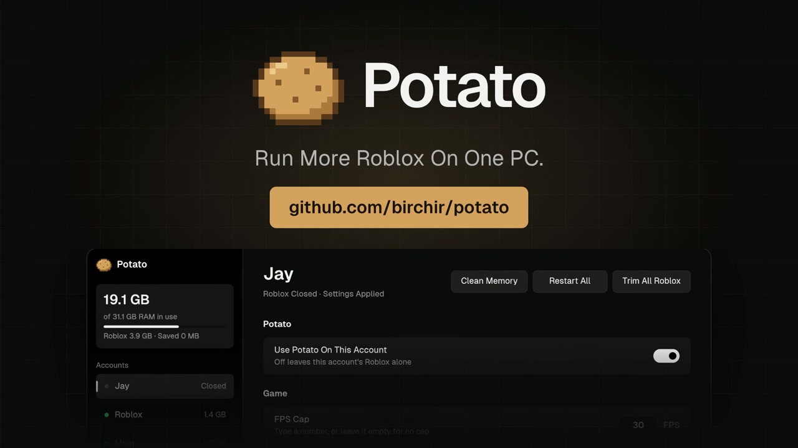
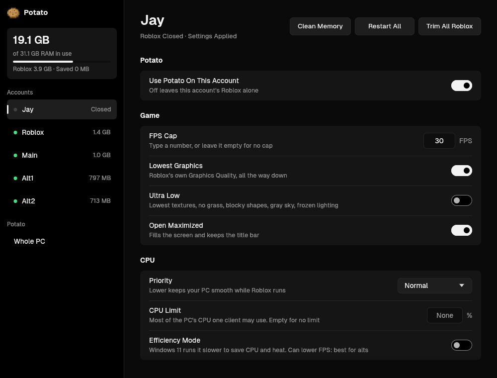

<p align="center">
  
</p>

<h1 align="center">Potato</h1>

<p align="center"><b>Run more Roblox on one PC.</b></p>

<p align="center">
  <a href="https://github.com/birchir/potato/releases/latest"></a>
  <a href="https://github.com/birchir/potato/releases"></a>
  <a href="https://github.com/birchir/potato/stargazers"></a>
  
  <a href="LICENSE"></a>
</p>

<p align="center">
  <a href="https://github.com/birchir/potato/releases/latest"><b>Download Potato.exe</b></a>
</p>

<p align="center">
  <a href="https://youtu.be/60MhHW1o3L8"></a>
</p>

<p align="center">
  
</p>

Potato is one small Windows app that turns every Roblox client on your PC down to the minimum: lowest graphics, the
FPS cap you type, trimmed RAM and a lower CPU priority. That includes clients in other Windows accounts' RDP logins,
so a PC running alts in several RDP sessions gets them all from one window, each with its own settings.

On a PC running 4 clients, one click of **Trim All Roblox** freed 3.4 GB.

## Install

1. Download `Potato.exe` from the [latest release](https://github.com/birchir/potato/releases/latest).
2. Run it. Windows warns about apps that aren't signed yet: click **More Info**, then **Run Anyway**.
3. Say yes to the admin prompt. Potato needs it to reach Roblox in other accounts' RDP logins.

Closing the window keeps Potato running in the tray. New versions install themselves from the banner at the top.

## What it does

| | |
|---|---|
| **Lowest graphics and an FPS cap** | Uses Roblox's own Graphics Quality and Maximum Frame Rate settings, per account, and puts them back every time Roblox rewrites them. |
| **Ultra Low** | Every Fast Flag Roblox still accepts that lowers quality: lowest textures, no grass, blockier shapes, a gray sky and frozen lighting. |
| **Trim RAM** | Moves memory Roblox isn't using to the page file, on a timer or a click, and empties Windows' standby memory when RAM gets full. |
| **CPU control** | Priority, a hard CPU limit per client, its own CPU cores and Windows 11 Efficiency Mode. |
| **Restart into the same server** | Closes clients and reopens each one in the server it was in, public or private. On a click, every few hours, or when a client grows past a memory limit you set. |
| **Clean up after outages** | One Client Only closes the older copy when a second Roblox opens on the same account. Rejoin After A Crash reopens a client that closed by itself. |
| **Open maximized** | Every Roblox window fills the screen with its title bar kept, in every RDP login. |
| **Discord reports** | Posts each account's RAM, CPU, uptime, freezes and restarts to a Discord webhook, with a screenshot of each RDP's Roblox. |
| **Upload cap and timer** | Limits how fast Roblox uploads on a slow connection, and turns the PC off at a time you pick. |

## Is it safe?

Potato never asks for your Roblox login and never reads your cookie. It doesn't inject into Roblox, read its memory
or unlock its frame rate. It changes Roblox's own settings files and uses the same Windows features as Task
Manager, Process Lasso and Mem Reduct. Every file it changes gets a backup first, and **Restore Original
Settings** puts them all back.

It works alongside macros that read the screen. Lowest Graphics and an FPS cap of 25 or more are the settings those
macros ask for themselves. Leave Ultra Low off on an account a macro runs, since it changes how the game looks.

## Compared to other tools

| | Potato | Mem Reduct | Process Lasso |
|---|:---:|:---:|:---:|
| Lowest graphics and FPS cap, per account | Yes | | |
| Works on Roblox in every RDP login | Yes | Yes | Yes |
| Trims Roblox's RAM | Yes | Yes | Yes |
| CPU priority, cores and limits | Yes | | Yes |
| Restarts a client into the same server | Yes | | |
| Discord status reports | Yes | | |
| Free and open source | Yes | Yes | Free tier |

## How it works

- **Settings:** each account's `AppData\Local\Roblox\GlobalBasicSettings_*.xml` (`SavedQualityLevel`,
  `GraphicsQualityLevel`, `FramerateCap`, `Fullscreen`). Potato only edits values already in the file, and only while
  that account's Roblox is closed, since Roblox writes the file when it exits.
- **Ultra Low:** `ClientAppSettings.json` in each Roblox version folder and in Bloxstrap's and Fishstrap's
  `Modifications` folder. Only flags on Roblox's
  [allowlist](https://devforum.roblox.com/t/allowlist-for-local-client-configuration-via-fast-flags/3966569),
  since Roblox ignores the rest. Your own flags stay. Roblox no longer accepts the old render-resolution flags, so
  Ultra Low can't make the game pixelated.
- **RDP logins:** Windows only lets a program move windows, play with audio and take screenshots in its own login. So
  Potato copies itself to `C:\ProgramData\Potato` and adds a hidden logon task that runs `Potato.exe --helper` in
  each login. The helper maximizes, mutes, counts freezes, takes screenshots and reopens clients there.
- **Restarts:** a public server comes from the client's own log (its last `Joining game` line, so teleports are
  followed), a private server from the link code in the command line it started with. The login ticket in that
  command line is never read out or stored. The helper then opens Roblox's own join link
  (`roblox://experiences/start?...`).
- **CPU and memory:** `SetPriorityClass`, `SetProcessAffinityMask`, job-object CPU caps and Efficiency Mode on each
  client; `EmptyWorkingSet` and `NtSetSystemInformation` for memory; a Windows QoS policy for the upload cap.
- **Updates:** the app checks GitHub's latest release every 10 minutes, downloads `Potato.exe`, checks it against the
  release's SHA-256 and restarts into it.

## Build

```powershell
cargo test --lib
cargo build --release
```

The settings logic is plain Rust and its tests run on any OS. Off Windows the app builds against fake accounts
(`src/system_demo.rs`), so `cargo test --test window -- --ignored` draws the real window to `target/window-*.png`
(needs a GPU, or a software Vulkan driver like lavapipe). The logo is a pixel map in `assets/logo.txt`;
`python scripts/icons.py` redraws the icon files from it.

## License

MIT. Not affiliated with Roblox Corporation. Geist font by Vercel, under the SIL Open Font License
(`assets/fonts/OFL.txt`).
